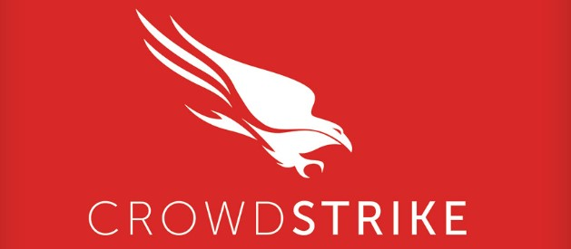

# CrowdStrike 

 

 CrowdStrike es una empresa estadounidense para la protección de endpoints, la nube y datos mediante inteligencia artificial y servicios a respuestas a amenazas. 

 CrowdStrike produce un conjunto de productos de software de seguridad para empresas, diseñados para proteger las computadoras de los ciberataques. Falcon, el agente de detección y respuesta de endpoints de CrowdStrike, trabaja a nivel del núcleo del sistema operativo en equipos individuales para detectar y prevenir amenazas. 

 

# Origin

 

 El origen de la actualización por la que ocurrio el incidente, fue porque que los atacantes empezaron a usar estos canales legítimos (Named Pipes) de Windows para esconder virus y moverse por los equipos sin ser detectados, mientras que el objetivo de la actualización CrowdStrike envió esa nueva regla para detectar y bloquear esa táctica específica, pero el error al leer la regla causó el desastre.c

 

# Causes

 

 El incidente consistió en que se puso un límite codificado rígidamente en el código fuente de la nueva regla de CrowdStrike, pero la función que llamaba esa variable no verificó si la cantidad de datos que estaba leyendo superaba ese máximo antes de repetirlos, por eso en la actualización del 19 de julio de 2024, esa variable iteradora intentó leer un valor en la memoria más allá del límite, que provoco que los equipos entraran en un bucle del modo de arranque, haciendo que se reiniciasen o fallasen continuamente.  

 

# Impact

 

 El alcance de este error llego al 1% de todos los equipos del mundo, una estimación de 8.5 millones de equipos de varios sectores. Los mas destacados fueron el de transporte aéreo en el cual lo sistemas de los aeropuertos, presentes en aviones y demás, se pusieron o en cuarentena o dejaron de funcionar,  provocando una parada en tierra en la que ningún vuelo de las aerolíneas estadounidenses como United, Delta y American Airlines pudo despegar, mientras que, en el sector de la salud, mas de 900 sistemas de varios países se vieron afectados, provocando interrupciones en los hospitales, haciendo que se tuviera que cambiar el formato de los tramites a papel temporalmente. Además, varias cirugías y emergencias fueron cerradas o pospuestas. 

 

# Conclusions

 

 Se puede observar como un simple fallo entre la comunicación de unos componentes puede dar lugar a fallos de múltiples sistemas, sumándole el riesgo de que sectores enteros se queden sin acceso a sus equipos.  

 

# References

 

https://www.crowdstrike.com/wp-content/uploads/2024/08/Channel-File-291-Incident-Root-Cause-Analysis-08.06.2024.pdf

https://www.crowdstrike.com/wp-content/uploads/2024/07/GlossaryOFTerms.pdf 

https://www.premiercontinuum.com/es/resources/interrupcion-microsoft-julio-2024

 

# Authors & Contributors

 

Izan Villalba Corzo - https://github.com/izillanv

Paul Alejandro Tamayo Mestanza - https://github.com/tamayonesa

Wuke Zhang - https://github.com/oOmyLoveOo
